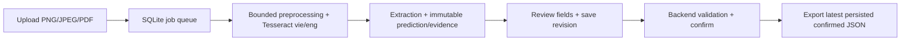

# AI-02 — OCR hóa đơn tiếng Việt

Một ứng dụng local: tải ảnh hóa đơn → OCR Tesseract tiếng Việt → trích xuất có vùng nguồn → sửa/lưu nháp → kiểm tra và xác nhận → tải JSON từ bản đã lưu trên server.

**Nền sản phẩm chính trên `main`:** React trong `frontend/`, FastAPI `docintel` trong `backend/`, native pipeline trong `pipeline/`, SQLite cho lịch sử/revisions. Nền kế thừa `nhatquang@a03ea30`, được tích hợp qua [PR #3](https://github.com/teamfuturetime/document-inteligence/pull/3); hướng dẫn nhóm qua [PR #14](https://github.com/teamfuturetime/document-inteligence/pull/14). [Quyết định nền](docs/decisions/0008-primary-invoice-platform.md) · [khảo sát nhánh tại thời điểm consolidation](docs/branch-inventory.md).

## Tiến độ tổng quan

Snapshot **27/11/2026**, đối chiếu [`main@2b52dc9`](https://github.com/teamfuturetime/document-inteligence/commit/2b52dc9783cee717bdd18a59f13e6661239fa0bd). [Issue cha #40](https://github.com/teamfuturetime/document-inteligence/issues/40) giữ phân công năm thành viên, dependencies và acceptance chi tiết; assignee mới chưa có nghĩa thành viên đã nhận/bắt đầu.

| Nhóm việc | Trạng thái tại snapshot |
|---|---|
| Nền local/web | **Đã có trên main:** Tesseract vie/eng, extraction/evidence và confidence heuristic; SQLite/worker, review/confirm/export, PDF một trang, autosave/session opt-in, error guidance/keyboard, backup verifier/publication và process crash tests. [CI main](https://github.com/teamfuturetime/document-inteligence/actions/runs/45136281283) thành công; không phải benchmark chất lượng OCR. |
| Phần đang chờ tích hợp | Restore [#44 / PR #62](https://github.com/teamfuturetime/document-inteligence/pull/62) và readiness/reconnect UI [#50 / PR #65](https://github.com/teamfuturetime/document-inteligence/pull/65) đã có review/CI đúng head, **chưa merge**. Ignore worktree [#74 / PR #75](https://github.com/teamfuturetime/document-inteligence/pull/75) còn cần review độc lập/tích hợp. |
| Baseline và cải tiến local | **Chưa bắt đầu đợt mới:** [#76 acceptance](https://github.com/teamfuturetime/document-inteligence/issues/76) → [#78 baseline/data QA](https://github.com/teamfuturetime/document-inteligence/issues/78) → [#79 phân tích lỗi](https://github.com/teamfuturetime/document-inteligence/issues/79) → [#80 preprocessing](https://github.com/teamfuturetime/document-inteligence/issues/80) → [#81 Tesseract](https://github.com/teamfuturetime/document-inteligence/issues/81) → [#82 extraction](https://github.com/teamfuturetime/document-inteligence/issues/82) → [#83 confidence/evidence](https://github.com/teamfuturetime/document-inteligence/issues/83). Các bước sau bị chặn bởi đầu ra trước; chỉ đổi khi có evidence trên development/validation, không tune test. |
| Nghiệm thu local/web | **Blocked:** [#84 stability local](https://github.com/teamfuturetime/document-inteligence/issues/84) chờ candidate và restore tích hợp; [#85 web local](https://github.com/teamfuturetime/document-inteligence/issues/85) chờ stability và reconnect UI. Không thay các coverage/QA đã có bằng lời hứa nghiệm thu mới. |
| API và Android | **Phase sau, chưa triển khai** — theo [#12](https://github.com/teamfuturetime/document-inteligence/issues/12) và gates ở #40: web local đạt acceptance → common internal contract + adapter từng provider → OCR API thật → web đầy đủ đạt acceptance → Android chỉ client dùng chung backend, **không OCR on-device**. Chưa chọn vendor. |

Human QA mẫu đã được [Tuấn xác nhận ở #5](https://github.com/teamfuturetime/document-inteligence/issues/5#issuecomment-7002179423): 18 ảnh synthetic/108 trường, không phải toàn bộ dataset hoặc độ chính xác hóa đơn thật. Snapshot này dựa trên đọc source/GitHub và CI từ xa, không ghi nhận một lượt tests/inference local mới. [Đầu ra README #77](https://github.com/teamfuturetime/document-inteligence/issues/77) được theo dõi riêng khỏi các tính năng trên.

## Bắt đầu từ checkout sạch

Cần Git, Python 3.14.5 (uv có thể cài theo `backend/.python-version`), uv 0.12.22, Node 24.16.x + npm 11.13.x, và Tesseract 5 trên PATH. Không cần PostgreSQL, API key hay GPU. Lần cài dependencies/models cần mạng; inference không tải model.

Các lệnh dưới dùng `python`; trên macOS/Linux nếu không có alias này, dùng `python3`. uv chọn Python backend theo pin, không cần sửa Python toàn máy.

Clone nền chung từ `main`:

```sh
git clone https://github.com/teamfuturetime/document-inteligence.git
cd document-inteligence
git switch main
python scripts/dev.py setup
python scripts/dev.py models
```

Với clone đã có sẵn, giữ các thay đổi local trên đúng nhánh trước, rồi `git fetch origin`, `git switch main`, `git pull --ff-only origin main`. Tạo nhánh task mới từ main theo [CONTRIBUTING](CONTRIBUTING.md); không dùng nhánh cá nhân cũ làm nền mặc định. [Trạng thái bàn giao GitHub](docs/github-publication.md) ghi các mốc đã tích hợp; theo dõi phân công hiện hành tại [issue #15](https://github.com/teamfuturetime/document-inteligence/issues/15).

`setup` cài đúng lockfiles và chỉ tạo `.env` khi chưa có; không ghi đè cấu hình cũ. File mẫu chọn `DOCINTEL_PROVIDER_MODE=tesseract`. Nếu giữ `.env` cũ, kiểm tra provider và runtime path. Nếu Tesseract không ở PATH, đặt `DOCINTEL_TESSERACT_EXECUTABLE` bằng đường dẫn cài thật. `models` tải vie+eng (~4,7MB), kiểm SHA256 và lưu dưới `runtime/` đã ignore.

Trước khi chạy app sau clone/pull, dùng `python scripts/dev.py doctor` hoặc thêm `--json --runtime runtime/app` để kiểm toolchain/config/runtime offline chỉ đọc. Không tự migrate, tạo DB hoặc tải models; xem [doctor và exit codes](docs/operations/doctor.md).

`scripts/dev.py` tìm executable trên PATH trước khi gọi subprocess, gồm launcher `npm.cmd` trên Windows; các lệnh setup/frontend/check/e2e vẫn dùng cùng entry point trên. Đường dẫn executable được chuyển thành tuyệt đối theo thư mục caller trước khi child chuyển về repo root, nên PATH tương đối có khoảng trắng vẫn hoạt động. Nếu báo `Executable not found on PATH`, kiểm `uv`/`npm` trong chính terminal đó rồi mở lại terminal sau khi cài công cụ. Không cần bật shell hoặc đổi lockfile để chạy npm. CI có job **Windows launcher checks** chạy setup, regression và frontend checks trên Windows thật; regression PATH tương đối chạy `shutil.which` và subprocess thật, mock chỉ kiểm thêm các entry points/arguments.

Chạy hai terminal từ repository root:

```sh
python scripts/dev.py backend
```

```sh
python scripts/dev.py frontend
```

Mở **http://127.0.0.1:5173**, chọn **Xử lý tài liệu**. API docs: http://127.0.0.1:8000/docs. Health `/api/v1/health` chỉ báo tiến trình; kiểm `/api/v1/capabilities` có `ocr_ready=true`. Một backend/worker cho mỗi runtime DB; không thêm `--workers` để vượt lock.

Nhánh issue #11 thêm **session opt-in** trong cùng app; mặc định vẫn `local` không đăng nhập.
Muốn dùng nhiều tài khoản, theo [hướng dẫn tài khoản/migration](docs/operations/auth-ownership.md)
để backup runtime cũ, tạo user offline và bật profile đúng cookie/origin. Không tự gán tài liệu
legacy cho người đầu tiên đăng nhập; đây chưa là cấu hình triển khai public.

## Luồng hóa đơn có thể thử ngay



1. Chọn hóa đơn, nguồn synthetic, ảnh `data/product/images/hoa_don_007.png`; xác nhận chính sách dữ liệu rồi upload.
2. Đợi OCR, đối chiếu vùng nguồn và sửa các trường. Thử xóa seller, lưu nháp, tải lại: giá trị null phải còn; chưa được xác nhận.
3. Điền lại theo ảnh, lưu, **Xác nhận bản lưu**, **Xuất JSON đã xác nhận**. Server kiểm run/revision; không lấy JSON tùy ý từ client.
4. Mở hai tab và lưu cùng revision để thấy 409; chạy OCR lại vẫn giữ lịch sử cũ. [Demo/backup/troubleshooting](docs/product/runbook.md).

## Kiểm tra trước PR

```sh
python scripts/dev.py check
python scripts/dev.py ocr
npm --prefix frontend exec -- playwright install chromium
python scripts/dev.py e2e
```

- `check`: offline backend/API/SQLite, contracts/data integrity, frontend static/component/build, frozen evaluator regression; không cần Tesseract/API key.
- `ocr`: chạy OCR thật + HTTP workflow, null/invalid input, conflict, export, history và restart. Thiếu engine/model thì fail, không skip/fallback.
- `e2e`: Chromium thật, backend native/SQLite tạm và Vite riêng; không tái dùng server/runtime đang mở. Cần models và browser đã cài.

Benchmark mới, output phải là thư mục chưa tồn tại:

```sh
uv run --project backend --locked python scripts/evaluate_model.py --split test --output runtime/evaluation/my-test-run
```

Mỗi số liệu phải đi cùng dataset/engine/model/config/source SHA. `evaluation/runs/2026-10-24-test-frozen` là bằng chứng Windows Tesseract5.4 của nền này; không lấy baseline core Tùng/solo làm metric ở đây. Frozen evaluator replay không phải inference mới. [Kiểm chứng consolidation](docs/consolidation-verification.md) ghi các lượt thực sự chạy.

## Phạm vi và giới hạn

Hóa đơn header/tổng tiền: invoice_number, invoice_date, seller_name, total_amount integer VND, currency. PNG/JPEG hoặc PDF một trang; mặc định 5MiB/16M pixels, deadline pipeline30s, tối đa5 pending/running jobs và một worker. Nhận body có tổng deadline 30 giây, tối đa hai upload đang nhận/tiền xử lý/lưu; đường chạy chuẩn giới hạn Uvicorn 16 connection/task. [Receive/admission, lỗi và giới hạn ingress](docs/operations/upload-ingress.md). PDF raster local ở 200 DPI, tối đa 8192 px mỗi chiều, dùng chung giới hạn pixel. Xem [hướng dẫn PDF](docs/operations/single-page-pdf.md). Chưa hỗ trợ nhiều trang, chữ viết tay hoặc line items. Evidence/confidence là heuristic chưa calibrated; người dùng vẫn phải đối chiếu ảnh.

Mặc định local một người dùng; có thể bật session và quyền theo chủ tài liệu theo hướng dẫn trên.
Chỉ synthetic/sample có quyền, không hồ sơ thật hoặc triển khai công khai. Đơn đề nghị 7 trường
và autosave/recovery theo owner tiếp tục hoạt động trong cùng app. PDF một trang tuân theo
[ADR0010](docs/decisions/0010-single-page-pdf.md). CCCD, đơn sinh viên và VLM/OCR.space theo
[kế hoạch port](docs/consolidation-plan.md).
[Bài tập VT-042..046](homework/README.md) giữ tại nguồn lịch sử.

## Cấu trúc và nguồn chuẩn

| Đường dẫn | Vai trò |
|---|---|
| `frontend/` | React/TS/Vite, upload/source/review/history và API types được sinh |
| `backend/src/docintel/` | API, domain nguồn chuẩn, use cases, SQLite migrations, storage/worker |
| `pipeline/src/document_pipeline/` | Preprocess/OCR/extraction; không đọc gold hoặc import web/DB |
| `contracts/` | JSON Schema/OpenAPI/examples sinh từ domain, không sửa tay |
| `data/` + `evaluation/` | Synthetic fixtures/product dataset và evaluator/native evidence tách riêng |
| `scripts/` | `dev.py` là entry point dev/check; generators/native/evaluation/backup helpers |
| `runtime/` | DB/uploads/models/cache/reports local, ignored, không commit |

[CONTRIBUTING](CONTRIBUTING.md): main → nhánh ngắn → PR → checks → review. [Tài liệu hiện hành](docs/README.md), [audit](docs/repository-audit.md), [migration](docs/consolidation-plan.md), [bản đồ mã](docs/codebase/STRUCTURE.md). Docker local trong runbook là đường tùy chọn; chưa được coi đã chạy nếu chỉ kiểm YAML.
