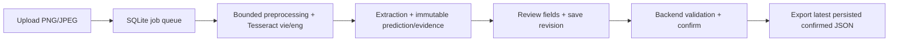

# AI-02 — OCR hóa đơn tiếng Việt

Một ứng dụng local: tải ảnh hóa đơn → OCR Tesseract tiếng Việt → trích xuất có vùng nguồn → sửa/lưu nháp → kiểm tra và xác nhận → tải JSON từ bản đã lưu trên server.

**Nền sản phẩm chính:** React trong `frontend/`, FastAPI `docintel` trong `backend/`, native pipeline trong `pipeline/`, SQLite cho lịch sử/revisions. Nhánh tổ chức lại `chore/repository-consolidation` kế thừa `nhatquang@a03ea30`. `main` là đích ổn định sau PR/review, hiện trên GitHub vẫn chỉ có README khởi tạo. Chưa merge hoặc thay default branch. [Quyết định nền](docs/decisions/0008-primary-invoice-platform.md) · [khảo sát 16 nhánh](docs/branch-inventory.md).

## Bắt đầu từ checkout sạch

Cần Git, Python 3.14.5 (uv có thể cài theo `backend/.python-version`), uv 0.12.22, Node 24.16.x + npm 11.13.x, và Tesseract 5 trên PATH. Không cần PostgreSQL, API key hay GPU. Lần cài dependencies/models cần mạng; inference không tải model.

Các lệnh dưới dùng `python`; trên macOS/Linux nếu không có alias này, dùng `python3`. uv chọn Python backend theo pin, không cần sửa Python toàn máy.

Trong giai đoạn chờ tích hợp main:

```sh
git clone https://github.com/teamfuturetime/document-inteligence.git
cd document-inteligence
git switch chore/repository-consolidation
python scripts/dev.py setup
python scripts/dev.py models
```

Lệnh `git switch` trên chỉ dùng sau khi người có quyền duyệt push nhánh consolidation; nếu nhánh chưa có trên remote, dùng worktree consolidation local đã bàn giao, không nhầm với main chỉ README. Sau khi PR nền được merge, clone mặc định vào main và tạo nhánh mới từ main theo CONTRIBUTING.

`setup` cài đúng lockfiles và chỉ tạo `.env` khi chưa có; không ghi đè cấu hình cũ. File mẫu chọn `DOCINTEL_PROVIDER_MODE=tesseract`. Nếu giữ `.env` cũ, kiểm tra provider và runtime path. Nếu Tesseract không ở PATH, đặt `DOCINTEL_TESSERACT_EXECUTABLE` bằng đường dẫn cài thật. `models` tải vie+eng (~4,7MB), kiểm SHA256 và lưu dưới `runtime/` đã ignore.

Chạy hai terminal từ repository root:

```sh
python scripts/dev.py backend
```

```sh
python scripts/dev.py frontend
```

Mở **http://127.0.0.1:5173**, chọn **Xử lý tài liệu**. API docs: http://127.0.0.1:8000/docs. Health `/api/v1/health` chỉ báo tiến trình; kiểm `/api/v1/capabilities` có `ocr_ready=true`. Một backend/worker cho mỗi runtime DB; không thêm `--workers` để vượt lock.

## Luồng hóa đơn có thể thử ngay



1. Chọn hóa đơn, nguồn synthetic, ảnh `data/product/images/hoa_don_007.png`; xác nhận chính sách dữ liệu rồi upload.
2. Đợi OCR, đối chiếu vùng nguồn và sửa các trường. Thử xóa seller, lưu nháp, tải lại: giá trị null phải còn; chưa được xác nhận.
3. Điền lại theo ảnh, lưu, **Xác nhận bản lưu**, **Xuất JSON đã xác nhận**. Server kiểm run/revision; không lấy JSON tùy ý từ client.
4. Mở hai tab và lưu cùng revision để thấy 409; chạy OCR lại vẫn giữ lịch sử cũ. [Demo/backup/troubleshooting](docs/product/runbook.md).

## Kiểm tra trước PR

```sh
python scripts/dev.py check
python scripts/dev.py ocr
npm --prefix frontend exec -- playwright install chromium
python scripts/dev.py e2e
```

- `check`: offline backend/API/SQLite, contracts/data integrity, frontend static/component/build, frozen evaluator regression; không cần Tesseract/API key.
- `ocr`: chạy OCR thật + HTTP workflow, null/invalid input, conflict, export, history và restart. Thiếu engine/model thì fail, không skip/fallback.
- `e2e`: Chromium thật, backend native/SQLite tạm và Vite riêng; không tái dùng server/runtime đang mở. Cần models và browser đã cài.

Benchmark mới, output phải là thư mục chưa tồn tại:

```sh
uv run --project backend --locked python scripts/evaluate_model.py --split test --output runtime/evaluation/my-test-run
```

Mỗi số liệu phải đi cùng dataset/engine/model/config/source SHA. `evaluation/runs/2026-10-24-test-frozen` là bằng chứng Windows Tesseract5.4 của nền này; không lấy baseline core Tùng/solo làm metric ở đây. Frozen evaluator replay không phải inference mới. [Kiểm chứng consolidation](docs/consolidation-verification.md) ghi các lượt thực sự chạy.

## Phạm vi và giới hạn

Hóa đơn header/tổng tiền: invoice_number, invoice_date, seller_name, total_amount integer VND, currency. PNG/JPEG một trang; mặc định 5MiB/16M pixels, deadline pipeline30s, tối đa5 pending/running jobs và một worker. Chưa PDF/multi-page/handwriting/line-items. Evidence/confidence là heuristic chưa calibrated; người dùng vẫn phải đối chiếu ảnh.

Local một người dùng, không auth/tenant isolation. Chỉ synthetic/sample có quyền, không hồ sơ thật. Đơn đề nghị 7 trường đang có tiếp tục hoạt động trong cùng app. CCCD, đơn sinh viên, autosave, PDF và VLM/OCR.space của các nhánh khác được [giữ tham chiếu và lên kế hoạch port](docs/consolidation-plan.md); không tuyên bố đã tích hợp chúng. [Bài tập VT-042..046](homework/README.md) giữ tại nguồn lịch sử.

## Cấu trúc và nguồn chuẩn

| Đường dẫn | Vai trò |
|---|---|
| `frontend/` | React/TS/Vite, upload/source/review/history và API types được sinh |
| `backend/src/docintel/` | API, domain nguồn chuẩn, use cases, SQLite migrations, storage/worker |
| `pipeline/src/document_pipeline/` | Preprocess/OCR/extraction; không đọc gold hoặc import web/DB |
| `contracts/` | JSON Schema/OpenAPI/examples sinh từ domain, không sửa tay |
| `data/` + `evaluation/` | Synthetic fixtures/product dataset và evaluator/native evidence tách riêng |
| `scripts/` | `dev.py` là entry point dev/check; generators/native/evaluation/backup helpers |
| `runtime/` | DB/uploads/models/cache/reports local, ignored, không commit |

[CONTRIBUTING](CONTRIBUTING.md): main → nhánh ngắn → PR → checks → review. [Tài liệu hiện hành](docs/README.md), [audit](docs/repository-audit.md), [migration](docs/consolidation-plan.md), [bản đồ mã](docs/codebase/STRUCTURE.md). Docker local trong runbook là đường tùy chọn; chưa được coi đã chạy nếu chỉ kiểm YAML.
