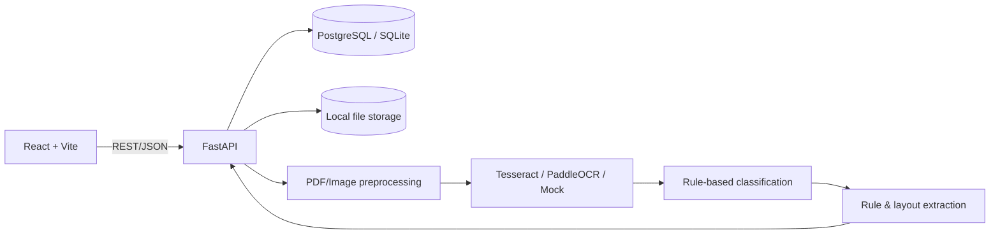

# Vietnamese Document Intelligence — AI-02

Ứng dụng web số hóa biểu mẫu tiếng Việt của nhóm **SE2026-T11 – Future Time**. Hệ thống nhận PDF/PNG/JPEG, chạy OCR, phân loại tài liệu, trích xuất dữ liệu có cấu trúc và cung cấp màn hình để người dùng đối chiếu, chỉnh sửa, xác nhận rồi xuất JSON.

> Đây là MVP phục vụ học tập/demo. Kết quả OCR và dữ liệu trích xuất luôn cần được kiểm tra với tài liệu gốc trước khi sử dụng.

## Mục lục

- [Tính năng](#tính-năng)
- [Kiến trúc và luồng xử lý](#kiến-trúc-và-luồng-xử-lý)
- [Công nghệ](#công-nghệ)
- [Chạy nhanh bằng Docker](#chạy-nhanh-bằng-docker)
- [Chạy môi trường phát triển](#chạy-môi-trường-phát-triển)
- [Cấu hình](#cấu-hình)
- [Sử dụng](#sử-dụng)
- [REST API](#rest-api)
- [Các loại tài liệu được hỗ trợ](#các-loại-tài-liệu-được-hỗ-trợ)
- [Kiểm thử](#kiểm-thử)
- [Lưu trữ, bảo mật và retention](#lưu-trữ-bảo-mật-và-retention)
- [Cấu trúc thư mục](#cấu-trúc-thư-mục)
- [Giới hạn hiện tại](#giới-hạn-hiện-tại)
- [Tài liệu chi tiết](#tài-liệu-chi-tiết)

## Tính năng

- Upload PDF, PNG, JPG hoặc JPEG, tối đa 15 MB theo cấu hình mặc định.
- Kiểm tra magic bytes và phần mở rộng để chặn file giả mạo định dạng.
- Chuyển từng trang PDF thành ảnh ở 200 DPI.
- Deskew, khử nhiễu, tăng tương phản CLAHE và threshold thích nghi cho engine có dùng preprocessing.
- OCR tiếng Việt/Anh bằng Tesseract; có adapter PaddleOCR và engine rỗng phục vụ kiểm thử.
- Chuẩn hóa Unicode tiếng Việt, confidence và bounding box về tọa độ `[0, 1]`.
- Phân loại theo từ khóa, trích xuất bằng regex và rule theo bố cục có version.
- Xem tài liệu gốc cạnh kết quả, sửa trường, lưu, xác nhận và xuất JSON.
- Tìm theo tên hoặc ID, lọc trạng thái/loại tài liệu và phân trang lịch sử.
- PostgreSQL khi chạy Docker, SQLite khi phát triển cục bộ.
- OpenAPI/Swagger, health check, CORS, API key tùy chọn và retention 41 ngày.

## Kiến trúc và luồng xử lý

Ứng dụng là một **modular monolith**: React gọi REST API FastAPI; backend quản lý metadata, file và điều phối package AI nội bộ.



Một tài liệu đi qua các trạng thái:

```text
uploaded → processing → review → confirmed
                      ↘ failed → processing (thử lại)
```

Endpoint xử lý trả `202 Accepted`, nhưng pipeline hiện vẫn chạy **đồng bộ trong request**. Với workload lớn, OCR nên được chuyển sang queue/worker.

## Công nghệ

| Thành phần | Công nghệ chính |
|---|---|
| Frontend | React 19, TypeScript, Vite 6, React Router, Axios, Tailwind CSS |
| Backend | Python 3.12, FastAPI, Pydantic, SQLAlchemy, Uvicorn |
| AI/OCR | OpenCV, PyMuPDF, pytesseract/Tesseract, PaddleOCR tùy chọn |
| Dữ liệu | PostgreSQL 16 trong Docker; SQLite mặc định khi chạy local |
| Hạ tầng | Docker Compose, Nginx, named volumes |
| Kiểm thử | pytest, FastAPI TestClient, httpx |

## Chạy nhanh bằng Docker

### Yêu cầu

- Docker Desktop hoặc Docker Engine có Docker Compose v2.
- Khuyến nghị tối thiểu 2 GB RAM trống cho backend/OCR.

Tại thư mục dự án:

```bash
docker compose up --build
```

| Dịch vụ | Địa chỉ |
|---|---|
| Giao diện | <http://localhost:5173> |
| Swagger UI | <http://localhost:8000/docs> |
| OpenAPI JSON | <http://localhost:8000/openapi.json> |
| Health check | <http://localhost:8000/health> |

Compose khởi chạy `db`, `backend` và `frontend`. PostgreSQL dùng volume `postgres_data`; file upload dùng volume `uploads`. Backend chạy 2 Uvicorn workers và OCR mặc định bằng **Tesseract `vie+eng`**.

```bash
# Xem log backend
docker compose logs -f backend

# Dừng nhưng giữ dữ liệu
docker compose down
```

Chỉ dùng `docker compose down -v` khi chủ động muốn xóa cả database và file trong named volumes.

### Ghi đè cấu hình Docker

`docker-compose.yml` hiện nạp trực tiếp `.env.example` cho backend. Để dùng cấu hình riêng hoặc secret, không sửa/commit secret vào file mẫu. Tạo `.env` (đã được `.gitignore`) và `docker-compose.override.yml`:

```yaml
services:
  backend:
    env_file:
      - .env
```

Sau đó chạy lại `docker compose up --build`; `.env` sẽ ghi đè các giá trị trùng tên.

## Chạy môi trường phát triển

### 1. Backend

Yêu cầu Python 3.12. Tesseract là chương trình hệ thống, không được cài bởi pip; hãy cài Tesseract cùng language pack tiếng Việt bằng package manager của hệ điều hành nếu dùng `OCR_ENGINE=tesseract`.

```bash
python3.12 -m venv .venv
source .venv/bin/activate
pip install -r backend/requirements-dev.txt
```

Tạo `.env` dùng SQLite để chạy độc lập với Docker:

```dotenv
APP_ENV=development
LOG_LEVEL=INFO
DATABASE_URL=sqlite:///./documents.db
STORAGE_DIR=./uploads
MAX_UPLOAD_MB=15
CORS_ORIGINS=http://localhost:5173
OCR_ENGINE=mock
API_KEY=
```

Khởi động API từ thư mục gốc repository:

```bash
PYTHONPATH=backend:. uvicorn app.main:app --reload
```

`mock` không tạo nội dung giả; engine này luôn trả OCR rỗng và phù hợp để kiểm tra luồng. Để nhận diện thật, đổi sang `tesseract` sau khi cài binary và language data `vie`.

### 2. Frontend

Yêu cầu Node.js 22 và npm. Mở terminal khác:

```bash
cd frontend
npm ci
npm run dev
```

Vite mặc định chạy tại <http://localhost:5173>. Trỏ frontend sang API khác bằng:

```bash
VITE_API_URL=http://localhost:8000/api/v1 npm run dev
```

### 3. PaddleOCR (tùy chọn)

PaddleOCR không nằm trong image Docker và không cần cho luồng mặc định:

```bash
pip install -r backend/requirements-ocr.txt
# Cài paddlepaddle CPU/GPU phù hợp với hệ điều hành, sau đó đặt OCR_ENGINE=paddle.
```

Model được lazy-load khi xử lý và có thể cần tải dữ liệu ở lần đầu. Repository không chứa model weights.

## Cấu hình

Backend đọc biến môi trường và file `.env` qua `pydantic-settings`.

| Biến | Mặc định trong mã | Docker hiện dùng | Ý nghĩa |
|---|---:|---:|---|
| `APP_ENV` | `development` | `development` | Tên môi trường trong health check |
| `LOG_LEVEL` | `INFO` | `INFO` | Mức log |
| `DATABASE_URL` | `sqlite:///./documents.db` | PostgreSQL service `db` | SQLAlchemy connection URL |
| `STORAGE_DIR` | `./uploads` | `/data/uploads` | Thư mục lưu file gốc |
| `MAX_UPLOAD_MB` | `15` | `15` | Dung lượng upload tối đa |
| `CORS_ORIGINS` | `http://localhost:5173` | giống mặc định | Các origin, phân tách bằng dấu phẩy |
| `OCR_ENGINE` | `mock` | `tesseract` | `mock`, `tesseract` hoặc `paddle` |
| `API_KEY` | rỗng | rỗng | Nếu có, API yêu cầu `X-API-Key` |
| `VITE_API_URL` | — | `http://localhost:8000/api/v1` | API URL được Vite nhúng lúc build |

`VITE_API_URL` là cấu hình frontend tại **build time**, không phải cấu hình runtime của FastAPI.

## Sử dụng

1. Mở **Tải tài liệu**, chọn PDF/PNG/JPG/JPEG không quá giới hạn.
2. Chọn **Tải lên và nhận diện**; trình duyệt upload file rồi gọi pipeline OCR.
3. Ở trang review, đối chiếu từng trường với preview tài liệu bên trái.
4. Sửa dữ liệu sai/thiếu và chọn **Lưu sửa đổi** hoặc **Lưu và xác nhận**.
5. Có thể tải kết quả hiện tại bằng **Xuất JSON**.
6. Trang **Lịch sử** hỗ trợ tìm tên/ID, lọc trạng thái/loại tài liệu và phân trang.
   Bấm **Tìm** để áp dụng bộ lọc; chuyển trang giữ nguyên bộ lọc đã áp dụng.
   Nếu tải dữ liệu thất bại, chọn **Thử lại**.

Thư mục [`demo_documents`](demo_documents/) chứa file PNG/PDF phục vụ demo. Không dùng giấy tờ chứa dữ liệu cá nhân thật trong môi trường không được bảo vệ.

## REST API

Base URL mặc định: `http://localhost:8000/api/v1`.

| Method | Endpoint | Mô tả | Thành công |
|---|---|---|---:|
| `POST` | `/documents` | Upload multipart field `file` | `201` |
| `GET` | `/documents` | Tìm kiếm, lọc, phân trang | `200` |
| `GET` | `/documents/{id}` | Metadata tài liệu | `200` |
| `GET` | `/documents/{id}/content` | Xem/tải file gốc inline | `200` |
| `POST` | `/documents/{id}/process` | Chạy/chạy lại pipeline | `202` |
| `GET` | `/documents/{id}/extraction` | Extraction mới nhất | `200` |
| `PATCH` | `/documents/{id}/extraction` | Lưu dữ liệu đã sửa | `200` |
| `POST` | `/documents/{id}/confirm` | Xác nhận extraction | `200` |

Query của `GET /documents`:

| Tham số | Mô tả |
|---|---|
| `q` | Tìm gần đúng theo tên hoặc khớp chính xác ID |
| `status` | `uploaded`, `processing`, `review`, `confirmed`, `failed` |
| `document_type` | Lọc loại tài liệu |
| `offset` | Vị trí bắt đầu, mặc định `0` |
| `limit` | Từ `1` đến `100`, mặc định `20` |

Ví dụ:

```bash
curl -F 'file=@demo_documents/01_can_cuoc_cong_dan.png' \
  http://localhost:8000/api/v1/documents

curl -X POST http://localhost:8000/api/v1/documents/DOCUMENT_ID/process
curl http://localhost:8000/api/v1/documents/DOCUMENT_ID/extraction
```

Nếu đặt `API_KEY`, thêm `-H 'X-API-Key: YOUR_KEY'`. Lỗi theo cấu trúc FastAPI `{ "detail": ... }`; mã thường gặp: `401` sai key, `404` không tìm thấy, `409` xung đột trạng thái, `422` file/payload sai và `503` pipeline thất bại.

## Các loại tài liệu được hỗ trợ

Extractor trả mỗi trường dưới dạng `{ value, confidence, source_text }`.

| `document_type` | Tài liệu | Trường dữ liệu |
|---|---|---|
| `identity_card` | Căn cước công dân | `id_number`, `full_name`, `date_of_birth`, `address` |
| `birth_certificate` | Giấy khai sinh | `full_name`, `date_of_birth`, `place_of_birth`, `father_name`, `mother_name` |
| `application_form` | Đơn đề nghị | `applicant_name`, `recipient`, `subject`, `date` |
| `invoice` | Hóa đơn | `customer`, `payment_recipient`, `total_amount`, `date` |
| `unknown` | Chưa nhận diện | Không có schema cố định; vẫn giữ raw OCR text |

Kết quả còn có `warnings`, `model_version`, `raw_text` và OCR từng trang (kích thước, text, confidence, bounding box) để review/audit.

Khi lưu sửa đổi, API chỉ cập nhật giá trị các trường đã tồn tại và đánh dấu
`reviewed` nếu giá trị thay đổi. Văn bản OCR, confidence, nguồn và tọa độ trang
được giữ nguyên. API chỉ cho sửa/xác nhận trong trạng thái `review`; request xử
lý trùng hoặc thao tác trong trạng thái không phù hợp trả `409`.

## Kiểm thử

```bash
# Backend
source .venv/bin/activate
pytest
pytest --cov=backend/app --cov=ai_service --cov-report=term-missing

# Frontend production build
cd frontend
npm ci
npm run build
```

Test suite gồm unit tests cho preprocessing, OCR, extraction, storage, security và repository; integration tests cho API; E2E test cho luồng upload → process → confirm. Module evaluation có CER, WER và field precision/recall/F1.

GitHub Actions tại [`.github/workflows/ci.yml`](.github/workflows/ci.yml) chạy
test backend với Python 3.12 và build frontend với Node.js 22 trên mỗi push,
pull request hoặc lần chạy thủ công. Test dùng OCR mock, SQLite và thư mục tạm;
không cần PostgreSQL, Tesseract hay model tải từ bên ngoài.

Các ca regression bao gồm tách cột OCR, tranh chấp quyền xử lý giữa các session,
rollback khi lưu extraction thất bại, giữ nguyên bằng chứng OCR khi chỉnh sửa,
khóa kết quả đã xác nhận và lọc/phân trang khi các tài liệu có cùng timestamp.

Kiểm tra cục bộ ngày **09/11/2026**: 99 test đạt, coverage backend/AI tổng hợp
87%, TypeScript và frontend production build đạt. Workflow CI mới cần được
push lên GitHub để chạy trên runner.

Repository chưa có dataset/ground truth đủ để công bố accuracy OCR hay extraction.

## Lưu trữ, bảo mật và retention

- File lưu bằng UUID; tên gốc chỉ là metadata.
- Đường dẫn được resolve/kiểm tra để chống path traversal.
- Backend kiểm tra chữ ký PDF/PNG/JPEG thay vì tin MIME header client.
- Log không chủ động ghi raw OCR text hoặc dữ liệu trường.
- `API_KEY` rỗng nghĩa là không xác thực. Khi có giá trị, mọi route tài liệu cần `X-API-Key`.
- Frontend hiện chưa gửi `X-API-Key`, và URL preview không gắn custom header. Nếu bật key, nên đặt identity-aware gateway phía trước hoặc bổ sung xác thực frontend.
- Mỗi tài liệu có `expires_at = created_at + 41 ngày`.

Job retention không tự được lên lịch. Sau khi backup, chạy hằng ngày từ host truy cập được đúng database/storage:

```bash
PYTHONPATH=backend:. python scripts/retention.py
```

Script xóa cả file hết hạn và metadata. Image backend hiện chưa copy `scripts/`, nên lệnh này không chạy trực tiếp trong container nếu chưa mount/copy script. Production cần scheduler, backup/restore, HTTPS, secret manager, rate limiting và phân quyền người dùng.

## Cấu trúc thư mục

```text
document-inteligence/
├── ai_service/
│   ├── classification/       # Phân loại theo rule/từ khóa
│   ├── evaluation/           # CER, WER và field metrics
│   ├── extraction/           # Schema, regex, layout extraction
│   ├── ocr/                  # Engine, geometry, normalization
│   ├── preprocessing/        # Decode, PDF, deskew, enhance
│   └── main.py               # Điều phối pipeline AI
├── backend/
│   ├── app/
│   │   ├── api/              # REST routes
│   │   ├── core/             # Config, DB, logging, security
│   │   ├── models/           # SQLAlchemy models
│   │   ├── repositories/     # Data access
│   │   ├── schemas/          # Request/response schemas
│   │   └── services/         # Storage, validation, processing
│   ├── migrations/           # Alembic migration ban đầu
│   └── requirements*.txt
├── frontend/                 # React + TypeScript + Tailwind
├── tests/                    # Unit, integration, E2E
├── demo_documents/           # Tài liệu mẫu
├── docs/                     # Tài liệu kỹ thuật
├── scripts/                  # Demo, dev, retention
├── docker-compose.yml
└── pyproject.toml
```

## Giới hạn hiện tại

- Classification/extraction chủ yếu dựa trên keyword/regex, chưa phải mô hình được huấn luyện cho mọi biểu mẫu Việt Nam.
- Chất lượng phụ thuộc độ phân giải, góc chụp, font và layout.
- Tesseract adapter bỏ pipeline threshold/deskew nội bộ; PaddleOCR dùng preprocessing của dự án.
- Xử lý đồng bộ có thể timeout với PDF dài; chưa có queue, progress từng trang hay cancellation.
- Backend tạo bảng bằng `metadata.create_all()` khi khởi động; chưa tự chạy chuỗi migration Alembic.
- Local storage/named volume không phù hợp khi scale nhiều host nếu thiếu shared object storage.
- Xác nhận là trạng thái cuối: API chặn xử lý lại tài liệu đã `confirmed`.
- Mục tiêu 421 người dùng đồng thời là mục tiêu thiết kế/kịch bản tải, chưa phải benchmark thực nghiệm.
- Repository chưa có LICENSE.

## Tài liệu chi tiết

- [Kiến trúc](docs/architecture.md) · [Pipeline](docs/pipeline.md) · [REST API](docs/api.md)
- [Database](docs/database.md) · [AI/OCR](docs/ai-models.md) · [Đánh giá](docs/evaluation.md)
- [Bảo mật](docs/security.md) · [Hiệu năng](docs/performance.md) · [Kịch bản demo](docs/demo.md)
- [Báo cáo đóng góp](docs/contribution-report.md)

## Nhóm phát triển

**SE2026-T11 – Future Time** · Dự án **AI-02**.

Chi tiết phân công tại [`docs/contribution-report.md`](docs/contribution-report.md).
