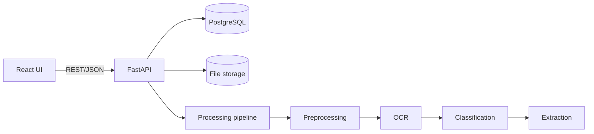

# Kiến trúc hệ thống

Hệ thống dùng kiến trúc modular monolith cho MVP. Frontend gọi REST API; backend
điều phối lưu trữ và pipeline AI. Các module AI là Python package độc lập để có
thể tách thành service khi tải tăng.

## Module

- `backend/app/api`: HTTP endpoints và dependency injection.
- `backend/app/services`: application use cases.
- `backend/app/repositories`: data access, không chứa HTTP logic.
- `ai_service`: xử lý ảnh và hiểu tài liệu, không phụ thuộc FastAPI.
- `frontend`: giao diện upload, preview, review và history.

## Giao tiếp và trạng thái

API trả JSON, dùng mã lỗi ổn định. Trạng thái tài liệu đi theo chuỗi
`uploaded → processing → review → confirmed` hoặc `failed`. Job chạy đồng bộ ở
MVP; production có thể thay bằng queue mà không đổi API công khai.

## RE-044

Thiết kế hướng tới 421 người dùng đồng thời bằng stateless API, connection pool,
giới hạn upload và khả năng scale worker. Metadata/file có chính sách lưu 41
ngày. Change request được phân loại và phản hồi trong 18 giờ.
