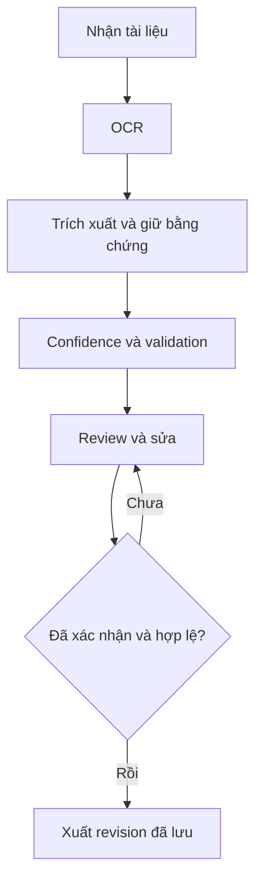

# Kiến trúc

**Snapshot foundation lịch sử.** Kiến trúc triển khai thêm ngày 24/10/2026 ở [product architecture](../product/architecture.md): backend services/storage/SQLite/worker và package pipeline, OCR thật và persisted review/export. Phần nền/đích dưới đây giữ để truy vết, không là feature status mới nhất.

## Nền đang có

React/TypeScript → API client `/api/v1` → FastAPI routes → FixtureService → OCR/extraction fixture adapters → file dự đoán/spans viết sẵn. Domain giữ kiểu dữ liệu và normalization/validation. Evaluator là package Python riêng trong backend, chạy offline từ entry point mỏng; không import app/server/frontend. Fixture adapters chỉ đọc `ocr.json`/`predictions.json`, không đọc annotations. Config ứng dụng tập trung trong `docintel/config.py`; `configs/foundation.json` là config của generator/evaluator, không tự bật fixture trong app.

Modules: `api` kiểm tra HTTP/lỗi; `services` điều phối xem fixture; `domain` contracts/rules; `adapters` Protocol và fixtures; `evaluation` metrics/manifest/CLI. Không có plugin framework, queue hay tám bảng CRUD hình thức. Ranh giới cần thay implementation là OCR/extraction; storage interface chỉ thêm khi BL-005 thực sự cần.

## Kiến trúc sản phẩm đích — chưa triển khai đầy đủ

MVP dùng SQLite local theo ADR stack provisional. BL-005 sẽ đặt migration có thứ tự tại `backend/migrations/` cùng runner rollback/upgrade tests khi bắt đầu persistence; chưa tạo thư mục trống hay tuyên bố workflow DB có sẵn. Upload/ảnh/DB nằm `runtime/` ngoài Git; UI nhận URL ứng dụng, không nhận đường dẫn đĩa. Document giữ checksum/provenance; mỗi OCR run immutable; revision và event lưu riêng; export đọc revision persisted/confirmed.

Chọn HTTP async run status khi tích hợp OCR tốn thời gian, bắt đầu bằng worker local có trạng thái persisted/recovery; không dùng queue phân tán cho foundation. Thiết kế phải tránh background task mất khi restart; BL-005 chốt điều phối và idempotency dựa trên spike latency. Schema mới như hóa đơn thêm domain definitions/schema registry và validator tương ứng; không gộp line items vào bảy field scalar.

Các lựa chọn đã áp dụng chỉ cho scaffold, chưa được nhóm phê duyệt cho sản phẩm cuối: [ADR](../adr/README.md).
