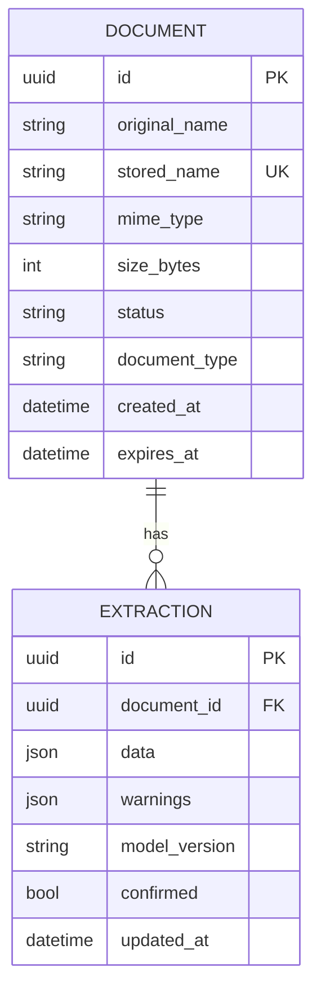

# Thiết kế dữ liệu

`stored_name` không lấy trực tiếp từ input để tránh path traversal. JSON giữ schema
linh hoạt giữa các loại biểu mẫu; các cột trạng thái và loại tài liệu được index
để phục vụ dashboard. `expires_at` mặc định 41 ngày theo RE-044. Việc xóa theo
retention phải xóa cả object và metadata trong một job có audit.
