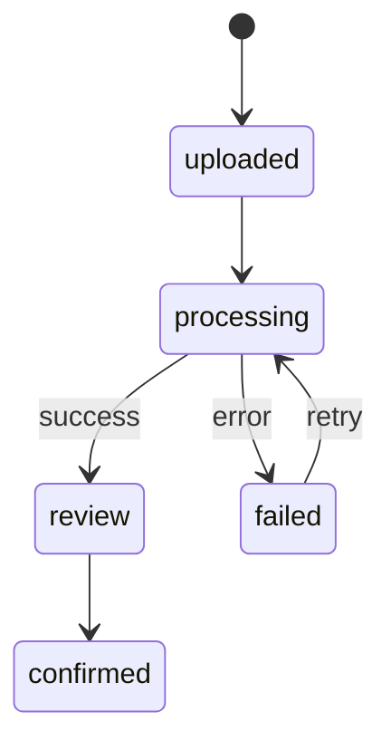

# Pipeline xử lý tài liệu

## Luồng chính

1. API nhận multipart file và kiểm tra kích thước, MIME signature.
2. File được lưu bằng tên UUID; tên gốc chỉ nằm trong metadata.
3. PDF được render theo trang; ảnh được sửa hướng, khử nhiễu và tăng tương phản.
4. OCR trả text, confidence và bounding box theo từng trang.
5. Classifier dự đoán loại biểu mẫu từ từ khóa và tín hiệu bố cục.
6. Extractor ánh xạ nội dung vào schema tương ứng.
7. Validator chuẩn hóa Unicode, ngày tháng, số định danh và cảnh báo dữ liệu.
8. Kết quả vào trạng thái `review`; người dùng sửa và xác nhận.

## Hợp đồng trung gian

Mỗi page có `width`, `height`, danh sách `blocks`. Mỗi block gồm `text`,
`confidence`, và box chuẩn hóa `[x1,y1,x2,y2]`. Kết quả extraction gồm
`document_type`, `fields`, `warnings`, `model_version` để audit được.

## Khả năng phục hồi

Mọi bước phải idempotent theo document ID. Exception được chuyển thành trạng
thái `failed` cùng mã lỗi an toàn; không ghi nội dung tài liệu vào log.
