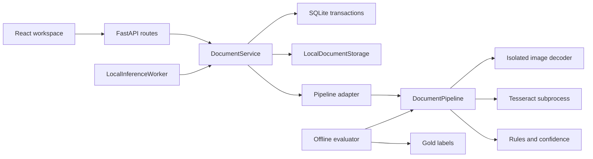

# Kiến trúc sản phẩm trên nhatquang

## Ranh giới đang triển khai

Gold chỉ có trong evaluator, không đi vào pipeline. Browser không đọc file model/DB/đường dẫn đĩa. SQLite là lựa chọn có chủ ý cho local/single-user; không thêm Redis, MinIO, microservices hoặc ORM chỉ để tạo thêm lớp.

| Thư mục | Trách nhiệm thực |
| --- | --- |
| frontend/src/features/documents | Upload/list/polling, review, source evidence, conflicts, history, server export |
| frontend/src/lib/api.generated.ts | Types sinh từ backend OpenAPI, không sửa tay |
| backend/src/docintel/api | HTTP validation, route, errors/request ID, CORS/origin guard |
| backend/src/docintel/domain/documents.py | Nguồn chuẩn product schemas, draft/final validation và export contracts |
| backend/src/docintel/services | Use cases, transactions, revision policy và persisted worker lifecycle |
| backend/src/docintel/repositories | SQLite connections/transaction boundary và migration SQL có version |
| backend/src/docintel/storage | File paths từ server IDs; source/preview bất biến, cleanup khi upload thất bại |
| backend/src/docintel/adapters/pipeline.py | Chuyển DTO inference sang public backend contract |
| pipeline/src/document_pipeline | Image/OCR/extraction/confidence, không phụ thuộc web hoặc DB |
| backend/src/docintel/evaluation | Metrics offline; evaluator fixture và model benchmark tách riêng |
| data/product, data/manifests | Synthetic images, annotations và provenance/splits/hashes |
| contracts/generated | JSON Schema/OpenAPI được sinh; fixture schema cũ không đổi nghĩa |
| scripts | CLI có nơi dùng: checks, model fetching, evaluation, backup và verification |
| runtime | Uploads, DB, models, local reports; ngoài Git |

## Trạng thái và tính nhất quán

Upload ghi source gốc và preview grayscale đã chuẩn EXIF, tạo document cùng queued run trong transaction. Queue giới hạn dùng cùng Settings; vượt giới hạn trả 429 và dọn file vừa tạo. Worker một instance nhận từng queued run từ SQLite, chuyển running, OCR có deadline rồi ghi immutable prediction snapshot và revision nháp đầu tiên. Source hash được kiểm lại trước xử lý.

Khi restart: queued vẫn có thể tiếp tục; running bị gián đoạn chuyển failed với PROCESSING_INTERRUPTED, không treo vĩnh viễn hoặc tự báo thành công. Runtime chỉ được chạy một app worker process; không dùng `--workers` lớn hơn 1. Đây là local worker, không cam kết hệ thống phân tán.

Review dùng run_id và expected_revision. SQLite BEGIN IMMEDIATE bao phủ check cùng insert, nên hai tab không thể ghi đè cùng revision. `is_reviewed=true, reviewed_value=null` là xóa. Prediction không bị sửa; lưu sau confirm tạo revision draft mới. Reprocess tạo run mới, giữ toàn bộ review cũ và chặn thao tác stale.

Confirm kiểm snapshot persisted mới nhất và validation. Export không nhận final data/approved từ client; backend tạo JSON từ confirmed revision, có schema/document/run/revision/provenance. Ngày phải tồn tại; số tiền VND là integer JSON an toàn; identifiers giữ số 0; unknown/missing vẫn lưu draft được.

## Tọa độ và đầu vào

Chỉ PNG/JPG một trang; mặc định 5 MiB, 16M pixels, timeout 30 giây và tối đa 5 run đang chờ/chạy. Định dạng kiểm từ decoder, không tin extension. Source preview và boxes đều ở frame EXIF-normalized pixels, page_index=0. Mọi rotation/scale OCR được chiếu ngược vào frame preview; không tự bịa bbox hoặc correction angle.

## Hợp đồng và phiên bản

App 0.2.0; product schema 1.0.0; foundation fixture/export schema 1.0.0 được giữ riêng. Backend domain sinh schemas và OpenAPI; frontend dùng generated types. Thay schema phải cập nhật generator, examples, tests, versions và docs trong cùng đợt. DTO trong pipeline là implementation interface, không nguồn API độc lập.
